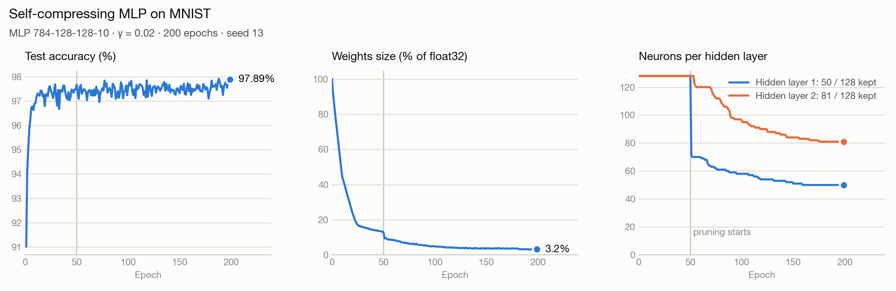

# Self Compressing Neural Networks

Self-Compressing Neural Networks in PyTorch: each neuron learns its own bit-width and quantization step
during training. Neurons whose bit-width reaches 0 are pruned, so the network shrinks while it trains.

## Results

<picture>
  <source media="(prefers-color-scheme: dark)" srcset="assets/mnist_training_dark.png">
  
</picture>

| Dataset | Model | Test accuracy | Weights size | Compression | Avg. bits / kept weight | Hidden neurons kept |
|---|---|---|---|---|---|---|
| MNIST | MLP 784-128-128-10 | 97.89% | 14.6 KB (float32: 461 KB) | ×31.7 | 2.71 | 128 → 50, 128 → 81 |

Final epoch of a single run (γ = 0.02, seed 13). Test accuracy moves by a few tenths of a point from one
epoch to the next; the average over the last 10 epochs is 97.66%. Sizes count the weights only: biases and
the per-neuron bit-width and exponent are not included, and bit-widths are still continuous (storing them
would need whole bits).

Reproduce with `python examples/mnist.py`, then `python examples/plot_mnist.py`.

## How it works

Each output neuron $i$ of a layer has two learnable parameters: a bit-width $b_i$ and an exponent $e_i$.
Its weights are quantized with

$$
q(w) = 2^{e_i} \cdot \mathrm{round}\left(\mathrm{clamp}\left(2^{-e_i} w,\; -2^{b_i-1},\; 2^{b_i-1}-1\right)\right)
$$

The rounding uses a straight-through estimator, so weights, bit-widths and exponents are all trained
by gradient descent. The loss adds a size penalty:

$$
\mathcal{L} = \mathcal{L}_{\text{task}} + \gamma \cdot \frac{\text{total bits}}{\text{number of weights}}
$$

A larger $\gamma$ pushes harder toward fewer bits. When a neuron reaches $b_i = 0$, all its weights
quantize to 0. The neuron is removed, and its constant output (the activation of its bias) is folded
into the bias of the next layer, so pruning does not change the network's output.


## Reference

Based on:

```bibtex
@article{csefalvay2023selfcompressing,
  title   = {Self-Compressing Neural Networks},
  author  = {Cs{\'e}falvay, Szabolcs and Imber, James},
  journal = {arXiv preprint arXiv:2301.13142},
  year    = {2023}
}
```


## License

MIT, see [LICENSE](LICENSE).